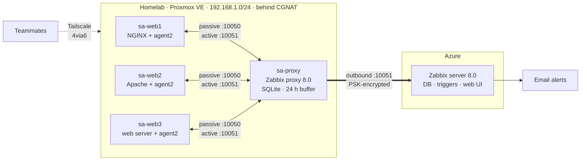

# salab: Hybrid Network Monitoring with Zabbix

Log centralization and network monitoring for three Linux web servers, installed by hand for a group sysadmin project at KMITL. I built the Proxmox homelab, proxy, firewall and team access. A teammate runs the Zabbix server on Azure.

My home internet is behind CGNAT, so Azure can't connect in. I put a Zabbix proxy at home to get around that. It collects from the agents over the LAN and sends everything out over one PSK-encrypted connection. If the internet drops, it buffers up to 24 hours of data.

## Architecture

| Host | Where | Role |
|---|---|---|
| sa-web1 / sa-web2 / sa-web3 | Proxmox VMs 211–213, Ubuntu 24.04 | Web servers (NGINX, Apache, …) + Zabbix agent2 |
| sa-proxy | Proxmox VM 214, Ubuntu 24.04 | Zabbix proxy: collects from agents, forwards to the server |
| Zabbix server | Azure VM | Stores data, evaluates triggers, sends alerts, serves dashboards |

## Status

| State | What |
|---|---|
| Done | Team access, Proxmox firewall (tested), sa-proxy, sa-web1 monitored end to end |
| In progress | sa-web2: added in Zabbix, Apache and agent not installed yet |
| Not started | sa-web3, log monitoring, the 8 email alerts |

## Why I built it this way

| Choice | Reason |
|---|---|
| Active + passive checks | Zabbix log monitoring only works as an active check |
| Proxmox firewall over ufw | Runs on the host, so a compromised VM can't turn it off. Only the proxy can reach the agents on 10050 |
| Tailscale 4via6 (site 7) | Every teammate's home LAN is also 192.168.1.0/24 |
| Per-person Proxmox accounts | Each one is limited to the lab pool |
| VMs over containers | Each VM has its own kernel, so the metrics are real |

## Documentation

| Doc | Contents |
|---|---|
| [00-progress](docs/00-progress.md) | Current status, next steps, decision log |
| [01-assignment](docs/01-assignment.md) | Requirements and how the design meets them |
| [02-architecture](docs/02-architecture.md) | Machines, data flow step by step, templates, fallback plan |
| [03-access](docs/03-access.md) | Proxmox accounts, Tailscale policy, 4via6 |
| [04-firewall](docs/04-firewall.md) | Firewall layers, every rule, test results |
| [05-zabbix-proxy](docs/05-zabbix-proxy.md) | Building the proxy, command by command |
| [06-zabbix-agent](docs/06-zabbix-agent.md) | Runbook: add a new web server to monitoring |
| [07-alerts](docs/07-alerts.md) | Alert items, triggers, how to demo each |
| [08-cli-labs](docs/08-cli-labs.md) | Watching each step from the terminal: `zabbix_get`, `tcpdump`, proxy DB, API |
| [09-qa-cheatsheet](docs/09-qa-cheatsheet.md) | Common questions and answers |

Sanitized configs are in [configs/](configs/). Secrets are never committed.

## Stack

Proxmox VE 9 · Ubuntu 24.04 · Zabbix 8.0 (server, proxy, agent2) · SQLite · NGINX · Apache · Tailscale · Microsoft Azure
