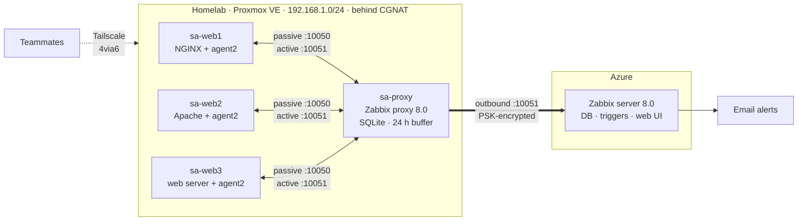

# salab — Hybrid Network Monitoring with Zabbix

Log centralization and network monitoring for three Linux web servers, built by hand on a **Proxmox homelab** with the monitoring server in **Azure**. Group project for *01276521 Practice of System Administration*, KMITL.

The interesting constraint: the homelab sits behind **carrier-grade NAT (CGNAT)**, so the cloud can never open a connection into it. The design works around that with a **Zabbix proxy** that only ever connects outbound, over a PSK-encrypted link, and buffers data if the internet drops.

## Architecture

| Host | Where | Role |
|---|---|---|
| sa-web1 / sa-web2 / sa-web3 | Proxmox VMs 211–213, Ubuntu 24.04 | Web servers (NGINX, Apache, …) + Zabbix agent2 |
| sa-proxy | Proxmox VM 214, Ubuntu 24.04 | Zabbix proxy: collects from agents, forwards to the server |
| Zabbix server | Azure VM | Stores data, evaluates triggers, sends alerts, serves dashboards |

## What it monitors

CPU, memory, network in/out, disk throughput, disk free space, uptime, web service state, system logs (auth, kernel) and web server error logs — each with an **email alert** (8 alerts total, e.g. unauthorized `sudo`, web service down, CPU > 75%). See [docs/07-alerts.md](docs/07-alerts.md).

## Key design decisions

| Decision | Why |
|---|---|
| **Zabbix proxy at home** instead of agents talking to the cloud | CGNAT blocks inbound connections and the public IP is shared with strangers. The proxy connects out, authenticates with a PSK, and buffers up to 24 h |
| **Active + passive checks** | Passive (proxy → agent :10050) for metrics and availability; active (agent → proxy :10051) for log monitoring, which is active-only |
| **Proxmox firewall** rather than ufw inside VMs | Enforced on the hypervisor, so a compromised VM can't disable it. One Security Group applies the same rules to every web VM; the agent port only accepts the proxy |
| **Tailscale 4via6** for team access | Every teammate's home LAN is also 192.168.1.0/24; 4via6 gives the lab a unique address range without renumbering |
| **Least-privilege accounts** | Per-person Proxmox accounts limited to the lab pool; Tailscale grants limited to the Proxmox UI and lab VMs |
| **VMs, not containers** | Each VM has its own kernel, so CPU/memory/disk metrics are real |

## Documentation

| Doc | Contents |
|---|---|
| [00-progress](docs/00-progress.md) | Current status, next steps, decision log |
| [01-assignment](docs/01-assignment.md) | Requirements and how the design meets them |
| [02-architecture](docs/02-architecture.md) | Machines, data flow step by step, templates, fallback plan |
| [03-access](docs/03-access.md) | Proxmox accounts, Tailscale policy, 4via6 |
| [04-firewall](docs/04-firewall.md) | Firewall layers, every rule, test results |
| [05-zabbix-proxy](docs/05-zabbix-proxy.md) | Building the proxy, command by command |
| [06-zabbix-agent](docs/06-zabbix-agent.md) | Runbook: add a new web server to monitoring |
| [07-alerts](docs/07-alerts.md) | Alert items, triggers, how to demo each |
| [08-cli-labs](docs/08-cli-labs.md) | Watching each step from the terminal: `zabbix_get`, `tcpdump`, proxy DB, API |
| [09-qa-cheatsheet](docs/09-qa-cheatsheet.md) | Common questions and answers |

Sanitized config files are in [configs/](configs/). Secrets (PSK keys, API tokens) are never committed.

## Stack

Proxmox VE 9 · Ubuntu 24.04 · Zabbix 8.0 (server, proxy, agent2) · SQLite · NGINX · Apache · Tailscale · Microsoft Azure

## Team

Chanathip (homelab, proxy, firewall, access) · Pollapat (sa-web1) · Supanut (sa-web2) · Tonkla · Azure server owner
