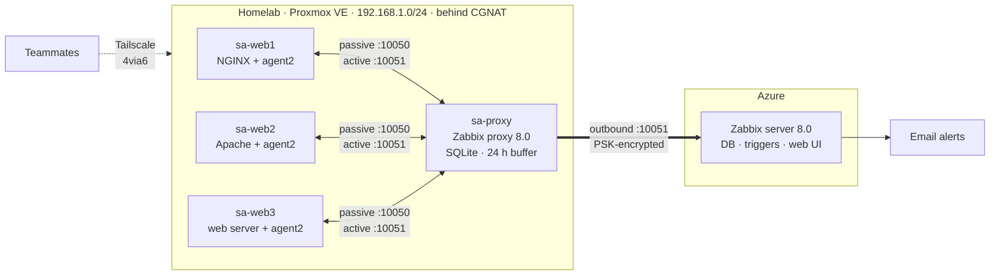

# salab: Hybrid Network Monitoring with Zabbix

This is a group project for *01276521 Practice of System Administration* at KMITL. The assignment is log centralization and network monitoring for at least three Linux web servers. Everything has to be open source and installed by hand, with 8 email alerts and a live demo at the end.

I built the homelab side: Proxmox, the Zabbix proxy, the firewall and team access. A teammate runs the Zabbix server on an Azure VM.

## The CGNAT problem

My home internet is behind CGNAT. My ISP shares one public IP between me and a bunch of other customers. I can reach the internet fine, but nothing on the internet can connect in to me.

That's a real problem when the monitoring server is in Azure and the web servers are in my house. We tried the simple way first and pointed the agents straight at Azure's public IP. It didn't work out. Azure could never connect back to the agents, and allowing my home IP on the Azure side would also allow every stranger sharing it.

So I chose to put a Zabbix proxy at home. The agents only talk to the proxy over the LAN. The proxy opens one outbound connection to Azure on port 10051, and since it starts from my side, CGNAT doesn't get in the way. The link is encrypted with a pre-shared key (PSK), which also proves it's really my proxy no matter who else is on that IP. If my internet drops, the proxy keeps up to 24 hours of data and sends it when the link comes back.

## Architecture

This diagram shows the full planned design. Only sa-web1 is connected so far, and the email alerts don't exist yet.

| Host | Where | Role |
|---|---|---|
| sa-web1 / sa-web2 / sa-web3 | Proxmox VMs 211–213, Ubuntu 24.04 | Web servers (NGINX, Apache, …) + Zabbix agent2 |
| sa-proxy | Proxmox VM 214, Ubuntu 24.04 | Zabbix proxy: collects from agents, forwards to the server |
| Zabbix server | Azure VM | Stores data, evaluates triggers, sends alerts, serves dashboards |

## Where it's at

Done and working:

- The Proxmox pool, per-person accounts and Tailscale access for the team.
- The Proxmox firewall, which I tested.
- sa-proxy, online and connected to Azure over PSK.
- sa-web1 (NGINX), monitored end to end.

Still to do:

- sa-web2 is in progress. The host is added in Zabbix, but Apache and the agent aren't installed yet.
- sa-web3 hasn't started. We haven't picked its web server.
- The alerts and email aren't built. Neither are the log monitoring items they depend on.

## What it monitors

Right now sa-web1 reports the standard metrics from Zabbix's Linux template: CPU, memory, network in/out, disk throughput, disk free space and uptime.

The plan adds web service state, system logs (auth, kernel) and web server error logs. On top of that come the 8 email alerts, like unauthorized `sudo`, web service down and CPU over 75%. The plan for each one is in [docs/07-alerts.md](docs/07-alerts.md).

## Why I set it up this way

- I use both passive and active checks. Passive means the proxy asks the agent on 10050. Active means the agent connects to the proxy on 10051, and Zabbix log monitoring only works that way. I learned this when I left out the 10051 rule on sa-proxy and the agent timed out.
- I chose the Proxmox firewall over ufw because it runs on the hypervisor, so a compromised VM can't turn it off. One Security Group on the web VMs allows 10050 only from the proxy, and sa-proxy allows 10051 only from the 3 web VMs. In my tests the proxy reached the agent and sa-web2 got blocked.
- Team access goes through Tailscale with 4via6 (site 7). Every teammate's home LAN is also 192.168.1.0/24, so normal subnet routes clash. 4via6 gives the lab its own addresses and nobody has to renumber anything.
- Everyone gets their own Proxmox account, limited to the lab pool. Tailscale only lets teammates reach the Proxmox UI and the lab VMs.
- I used VMs instead of containers. Each VM has its own kernel, so the CPU, memory and disk numbers are real.

## Documentation

| Doc | Contents |
|---|---|
| [00-progress](docs/00-progress.md) | Current status, next steps, decision log |
| [01-assignment](docs/01-assignment.md) | Requirements and how the design meets them |
| [02-architecture](docs/02-architecture.md) | Machines, data flow step by step, templates, fallback plan |
| [03-access](docs/03-access.md) | Proxmox accounts, Tailscale policy, 4via6 |
| [04-firewall](docs/04-firewall.md) | Firewall layers, every rule, test results |
| [05-zabbix-proxy](docs/05-zabbix-proxy.md) | Building the proxy, command by command |
| [06-zabbix-agent](docs/06-zabbix-agent.md) | Runbook: add a new web server to monitoring |
| [07-alerts](docs/07-alerts.md) | Alert items, triggers, how to demo each |
| [08-cli-labs](docs/08-cli-labs.md) | Watching each step from the terminal: `zabbix_get`, `tcpdump`, proxy DB, API |
| [09-qa-cheatsheet](docs/09-qa-cheatsheet.md) | Common questions and answers |

Sanitized config files are in [configs/](configs/). Secrets like PSK keys and API tokens never get committed.

## Stack

Proxmox VE 9 · Ubuntu 24.04 · Zabbix 8.0 (server, proxy, agent2) · SQLite · NGINX · Apache · Tailscale · Microsoft Azure
