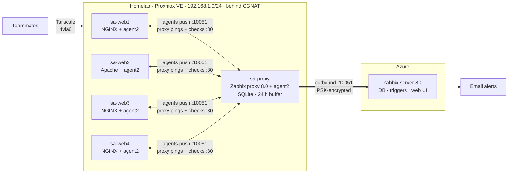
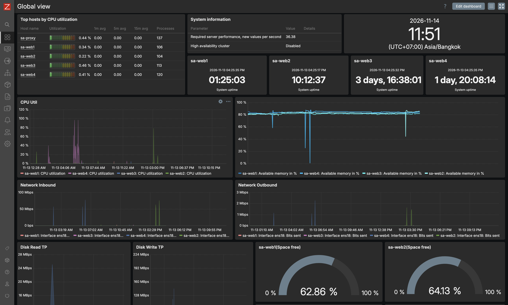
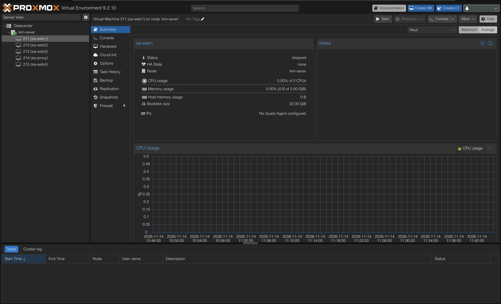

# salab: Hybrid Network Monitoring with Zabbix

Log centralization and network monitoring for four Linux web servers, built by hand for a group sysadmin project at KMITL. Done and demoed on Nov 13, 2026.

I built most of the infrastructure: the Proxmox homelab, proxy, firewall, team access, triggers, email alerts, dashboard and test scripts. Teammates set up the web VMs, and one runs the Zabbix server on Azure.

My home internet is behind CGNAT, so Azure can't connect in. I put a Zabbix proxy at home to get around that. It collects from the agents over the LAN and sends everything out over one PSK-encrypted connection. When my public IP changed mid-project, the proxy was offline for 3.5 hours and delivered the buffered data afterwards.

## Architecture

| Host | Where | Role |
|---|---|---|
| sa-web1 to sa-web4 | Proxmox VMs 211–213 and 215, Ubuntu 24.04 | Web servers (3 NGINX, 1 Apache) + Zabbix agent2 |
| sa-proxy | Proxmox VM 214, Ubuntu 24.04 | Zabbix proxy: collects from agents, probes the VMs, forwards to the server |
| Zabbix server | Azure VM, Docker Compose | Stores data, evaluates triggers, sends alerts, serves dashboards |

## What it monitors

| Area | What |
|---|---|
| Metrics | CPU, memory, network in/out, disk read/write, disk free, uptime, most every 10 s |
| Logs | auth, kernel, web access and web error logs from every VM, searchable in Zabbix |
| Availability | Ping and port 80 checked from the proxy, so a dead VM still shows as down |
| Alerts | The 8 required email alerts plus VM down and agent down, one email per problem |

## Screenshots

Zabbix Global view with all four web VMs and the proxy reporting:

The lab VMs in Proxmox (sa-web1 was shut down when I took this):

## Why I built it this way

| Choice | Reason |
|---|---|
| Agent checks + proxy probes | Agents push metrics and logs, but their data goes stale when a VM dies. The proxy's ping and port 80 checks don't |
| Trigger dependencies | A powered-off VM sends one email, not three |
| Proxmox firewall over ufw | Runs on the host, so a compromised VM can't turn it off. Only the proxy can reach the agents on 10050 |
| Tailscale 4via6 (site 7) | Every teammate's home LAN is also 192.168.1.0/24 |
| Per-person Proxmox accounts | Each one is limited to the lab pool |
| VMs over containers | Each VM has its own kernel, so the metrics are real |

## Documentation

| Doc | Contents |
|---|---|
| [00-progress](docs/00-progress.md) | Final status and decision log |
| [01-assignment](docs/01-assignment.md) | Requirements and how the design meets them |
| [02-architecture](docs/02-architecture.md) | Machines, data flow, templates, inside vs outside checks |
| [03-access](docs/03-access.md) | Proxmox accounts, Tailscale policy, 4via6 |
| [04-firewall](docs/04-firewall.md) | Firewall layers, every rule, test results |
| [05-zabbix-proxy](docs/05-zabbix-proxy.md) | Building the proxy, command by command |
| [06-zabbix-agent](docs/06-zabbix-agent.md) | Runbook: add a new web server to monitoring |
| [07-alerts](docs/07-alerts.md) | Final triggers, lessons from testing, test commands |
| [08-cli-labs](docs/08-cli-labs.md) | Watching each step from the terminal: `zabbix_get`, `tcpdump`, proxy DB, API |
| [09-qa-cheatsheet](docs/09-qa-cheatsheet.md) | Common questions and answers |
| [10-timing](docs/10-timing.md) | Every timer from agent to dashboard |
| [11-demo](docs/11-demo.md) | How the demo ran, test scripts |
| [12-cheatsheet](docs/12-cheatsheet.md) | Command cheat sheet |

Sanitized configs are in [configs/](configs/). Secrets are never committed.

## Stack

Proxmox VE 9 · Ubuntu 24.04 · Zabbix 8.0 (server, proxy, agent2) · SQLite · NGINX · Apache · Tailscale · Docker Compose · Microsoft Azure
